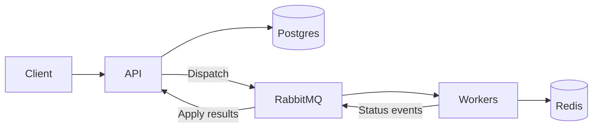

# Bifrost

A distributed background job service built with Python, FastAPI, Postgres, RabbitMQ, and Redis. Submit work through an HTTP API, run it across independently scalable workers, and track its status, progress, results, and history.

Bifrost supports email, webhook, report, and batch jobs, with scheduled execution, priority queues, automatic retries with exponential backoff, and idempotent submissions. Pending jobs can be cancelled; failed jobs can be retried manually.

## How it works



The API owns job state and scheduling in Postgres. Workers receive work through RabbitMQ and report progress and outcomes through a separate status queue. Redis coordinates execution claims and retains outcomes so duplicate deliveries can reuse a result.

Durable messages, confirmed publication, guarded state transitions, and timeout recovery keep work moving through service restarts and worker failures. Delivery is at least once; handlers with external effects need idempotency. Workers scale independently of the API.

## Quick start

Requires Make, Docker with Compose v2, and Python 3.

```sh
make up
curl http://localhost:8000/health
```

`make up` generates `.env` with local credentials if needed, builds and starts all services, and waits for readiness. The API is available at `http://localhost:8000`, with interactive API documentation at `/docs`. Job endpoints require the bearer token from `.env`.

To stop the local deployment:

```sh
make down
```

Persisted data is kept, ready for the next `make up`.

## Submit a job

```sh
set -a
. ./.env
set +a

curl http://localhost:8000/jobs \
  -H "Authorization: Bearer $API_TOKEN" \
  -H 'Content-Type: application/json' \
  -d '{
    "type": "email",
    "payload": {"to": "hello@example.com", "subject": "Hello"},
    "priority": 4,
    "idempotency_key": "welcome-1"
  }'
```

Returns a job ID with HTTP 202. Reusing the idempotency key returns the existing job with HTTP 200.

| Method | Endpoint | Purpose |
| --- | --- | --- |
| POST | `/jobs` | Submit work |
| GET | `/jobs/{id}` | Get status, progress, result, or error |
| GET | `/jobs` | List jobs by status and type |
| GET | `/jobs/{id}/logs` | Read job history |
| POST | `/jobs/{id}/cancel` | Cancel before dispatch |
| POST | `/jobs/{id}/retry` | Retry a failed job once |
| GET | `/health` | Check dependencies and queue statistics |

## Scale and monitor

```sh
docker compose up -d --scale worker=3
docker compose logs -f api worker
```

Services emit structured JSON logs. `/health` reports dependency connectivity, job counts, queue depth, and worker consumers. Data persists in named volumes across restarts and `make down`.

## Test

With Python 3.12+ and [uv](https://docs.astral.sh/uv/) installed:

```sh
make test
```

`make test` runs every E2E test with per-test results and a final pass/fail summary in the terminal. Each run builds an isolated Docker stack, tests the API and real dependencies—including concurrency, crashes, retries, and restart recovery—then collects diagnostics and removes its own resources. The local deployment can keep running alongside it.

JUnit results (`results.xml`), service logs (`stack.log`), and build details (`build.json`) are saved under `artifacts/bifrost-test-<run-id>/`. A failed test, startup, or cleanup makes the command exit with an error.

Run `make` or `make help` for a command summary.

See [design decisions](DECISIONS.md), [test coverage](docs/acceptance.md), [test results](docs/implementation.md), and [AI usage](AI_USAGE.md) for more detail. Configuration defaults live in [config.py](bifrost/config.py); deployment settings are in [compose.yaml](compose.yaml).
