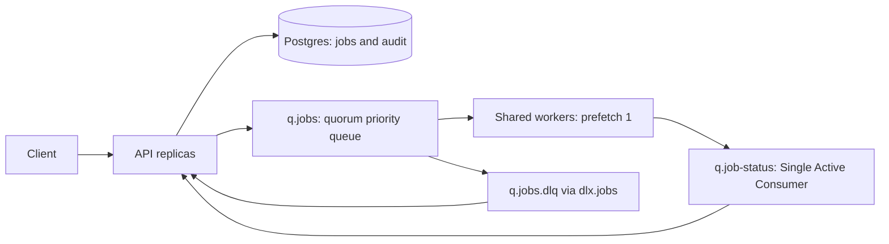

# Bifrost

A small distributed job queue: Python 3.12/FastAPI, Postgres 16, RabbitMQ 4.3, and independently scalable asynchronous workers. All handlers are mocks; none sends email, requests a webhook, or uploads a report.

## Run

Requires Docker Engine with Compose v2, Python 3.12+, and [uv](https://docs.astral.sh/uv/). Docker Desktop must be running when used from WSL.

```sh
python3 scripts/configure.py
uv sync --frozen
docker compose up -d --build --wait
curl http://localhost:8000/health
```

`configure.py` creates an ignored `.env` with random credentials and refuses to overwrite it. Alternatively fill `.env.example` and save it as `.env`. Only the API is published, bound to loopback. Postgres and RabbitMQ persist in named volumes. `docker compose down` retains them; `down -v` destroys this deployment's data.

Get the API token from your `.env` and export it in your terminal:

```sh
set -a
. ./.env
set +a
curl -i http://localhost:8000/jobs \
  -H "Authorization: Bearer $API_TOKEN" -H 'Content-Type: application/json' \
  -d '{"type":"email","payload":{"to":"a@example.com","subject":"Hello"},"idempotency_key":"example-1"}'
```

Use the returned UUID:

```sh
curl http://localhost:8000/jobs/UUID -H "Authorization: Bearer $API_TOKEN"
curl 'http://localhost:8000/jobs?status=completed&type=email&limit=10&offset=0' \
  -H "Authorization: Bearer $API_TOKEN"
curl http://localhost:8000/jobs/UUID/logs -H "Authorization: Bearer $API_TOKEN"
curl -X POST http://localhost:8000/jobs/UUID/cancel -H "Authorization: Bearer $API_TOKEN"
curl -X POST http://localhost:8000/jobs/UUID/retry -H "Authorization: Bearer $API_TOKEN"
```

OpenAPI is at `/docs`. New submissions return 202; a repeated key returns 200 and the original job's **current** state with `deduplicated=true`, without changing any submission attributes. Unknown UUIDs return 404. Successful cancellation returns 200; retry returns 202. Ineligible actions return 409. Errors consistently use `{ "error": { "code": "...", "message": "..." } }`, with validation details for 422 responses. Authentication failures return 401, rate limits 429.

## Contracts

| Type | Payload | Successful result |
|---|---|---|
| email | `{"to":"a@example.com","subject":"optional","body":"optional"}` | stable `message_id` derived from job UUID |
| webhook | `{"url":"https://example.com/hook","data":{}}` | mock `status_code: 200` |
| report | `{"parameters":{"period":"monthly"}}` | stable `file_url` under `reports.invalid` |
| batch | `{"items":["a","b"]}` | `processed_count` and `summary` containing processed items |

Payloads reject unknown fields and non-finite JSON numbers, and exceed neither 64 KiB serialized JSON nor 1,000 batch items. Empty batches return count zero and an empty summary. Priority is a strict integer 0–31, default 4; max_attempts is 1–5, default 3. Idempotency keys have 1–200 characters. Supplied schedules must contain a timezone; omitted or past times are immediately eligible. Listings default to 50 and accept 1–100 items with a nonnegative offset. Jobs sort newest first with UUID tie-breaking; audit logs sort oldest first with numeric ID tie-breaking.

Cancellation is allowed only from pending/scheduled, including retry backoff. Once the reservation commits, dispatch wins even if publication has not completed. Scheduling and retry times always override priority.

Automatic retries keep the latest error visible while waiting and preserve priority. Backoff is 30, 120, 480, then 1,920 seconds. Permanent failure ends a cycle immediately. One manual retry grants a fresh cycle; it preserves identity, payload, lifetime counts, first start, and history, but clears attempt-local output/timing and ignores the original schedule. Attempts count **accepted logical attempts**, not every physical execution.

## Architecture and failure boundaries



API-side scheduler, publication recovery, status application, reaper, dead-letter handling, and cleanup share guarded lifecycle transitions. Workers have broker credentials and **no database configuration**. A short Postgres transaction reserves due work with `FOR UPDATE SKIP LOCKED`, assigns its token, and commits before publication. The row's leased recovery time coordinates uncertain publications among API replicas. Confirmed backlog is left in RabbitMQ while workers are offline.

Each worker confirms its processing event before execution, then its final event before acknowledging work. Business failures are acknowledged; the API decides retries. Status consumers use prefetch 1 and Single Active Consumer failover; acknowledgement follows the atomic state/audit commit. A current-token final outcome can atomically imply its missing start. Repeated starts do not count again. Ended tokens are invalidated; stale events, progress, and dead letters cannot reopen accepted outcomes. Progress never decreases within an attempt; success sets 100.

Timeouts are email/webhook 15 seconds, report 60, batch 180. A reaper uses the first accepted attempt start plus that timeout and a recovery allowance. Progress cannot extend this deadline. A lost worker may be redelivered with the same token, or its abandoned attempt may enter a new business retry.

The guarantee is at least once with guarded persistent state. Uncertain broker acceptance, connection loss, and crashes before acknowledgement can repeat physical execution, possibly overlapping it. Tokens do not prevent side effects. Stable mock result IDs and unique audit entries do not prove physical execution happened once. There is no outbox, admission RPC, heartbeat protocol, lossless DLQ transfer, or automatic DLQ replay.

RabbitMQ 4.3 provides [32 native strict quorum priorities](https://www.rabbitmq.com/docs/priority). Preference applies to eligible same-type work still awaiting dispatch/delivery; it does not preempt work already delivered. Redelivery ordering may differ. This single-node quorum deployment does not supply replicated high availability. See [DECISIONS.md](DECISIONS.md) and [implementation decisions](docs/implementation.md).

## Scale and observe

```sh
docker compose up -d --scale worker=3
# Independent ephemeral loopback ports avoid replica port conflicts:
API_PORT=0 docker compose up -d --scale api=2 --scale worker=3
docker compose port --index 1 api 8000
docker compose port --index 2 api 8000
docker compose logs -f api worker
```

`/health` is unauthenticated. It reports database/broker connectivity, counts for every job state, ready/unacknowledged work, work consumers, status backlog, and dead-letter depth. A required dependency outage returns 503. Missing management statistics or zero workers returns 200 with degraded status; statistics are explicitly unavailable rather than zero, with `statistics_error` identifying a failed probe or missing field. Broker management statistics are sampled and may lag delivery. Connected consumers do not establish handler health.

Application logs are structured JSON with component and applicable job/type/cycle/attempt/token context. Unexpected background bugs terminate the process so the restart policy can act. Expected dependency failures reconnect with bounded backoff. SIGTERM cancels intake and finishes the current bounded delivery and confirmed final publication. The 220-second Compose shutdown allowance exceeds the longest handler timeout. If the API exits first, durable final events wait for it to return.

Cleanup runs hourly in batches of 500, deleting logs older than 30 days and releasing keys only for terminal jobs whose terminal and creation times are older than 30 days. Active keys and younger keys remain protected. Job rows remain indefinitely; this is best-effort housekeeping, not bounded storage.

## Verify

One command builds the actual images, creates a unique Compose project with random credentials and isolated volumes, waits for readiness, drives HTTP and the real broker, runs fault/concurrency tests, captures diagnostics, and removes only that project's resources:

```sh
uv run python scripts/e2e.py
```

The exit code is nonzero on a failed test or failed deployment. Redacted logs and per-test failure details are under `artifacts/bifrost-test-*`. Tests assert eventual progress with deadlines and last observed state. Container lifecycle controls and broker injection run from the separate host test process; application logic is not called in-process. Run a single slice by passing pytest selectors:

```sh
uv run python scripts/e2e.py tests/e2e/test_delivery.py
uv run ruff check bifrost tests scripts
uv run ruff format --check bifrost tests scripts
uv run ty check bifrost
```

On WSL, an optional `UV_PROJECT_ENVIRONMENT=/tmp/bifrost-venv` keeps dependency imports on the Linux filesystem. All deployed application code still comes from the repository's Docker build context.

See [acceptance coverage](docs/acceptance.md) and [execution evidence](docs/implementation.md). Fault hooks and shortened timings require explicit `TEST_MODE=true` and are inactive in ordinary deployment. Tests use immutable payload `_test` controls for `fail_first` (first N lifetime attempts), `permanent`, real-second `delay` (null uses the normal delay), and `pause_at`; these are rejected in ordinary mode. `pause_at` self-arms once per job/container at `after_reserve`, `after_publish`, `before_processing`, `during_execution`, or `after_final`, avoiding a race between dispatch and external hook installation. Test-only pause files also target status commit/ack and reaper polling. They pause the real path and never replace database or broker operations.

## Configuration

Credentials: `DATABASE_URL` and `API_TOKEN` belong only to API; `BROKER_URL` belongs to both. Compose builds URLs from `.env` credentials. Other defaults:

| Variable | Default | Purpose |
|---|---:|---|
| TICK_SECONDS | 2 | Due selection and publication recovery polling |
| RECOVERY_SECONDS | 10 | Lease before an uncertain publication is eligible again |
| REAPER_SECONDS | 10 | Expired processing poll |
| RECOVERY_ALLOWANCE | 5 | Seconds beyond the handler timeout before reaping |
| CLEANUP_SECONDS | 3600 | Batched best-effort housekeeping poll |
| SUBMIT_LIMIT | 120 | Submissions per process per 60 seconds |
| RETRY_LIMIT | 30 | Manual retry calls per process per 60 seconds |
| RETRY_BASE | 30 | First retry delay; overriding requires test mode |
| TIME_SCALE | 1 | Mock handler timing and timeout factor, test mode only |

Per-process rate limiting is intentionally not globally coordinated. Idempotency keys are retained until eligible terminal cleanup, at least 24 hours and indefinitely while active. Secrets are not included in source, images, or test diagnostics. This exercise's shared bearer token and shared broker identity are not production identity management.

With more time, define handler-specific idempotency before introducing any real external effects, including failures between performing an effect and publishing completion. [AI_USAGE.md](AI_USAGE.md) records assistance and corrections.
