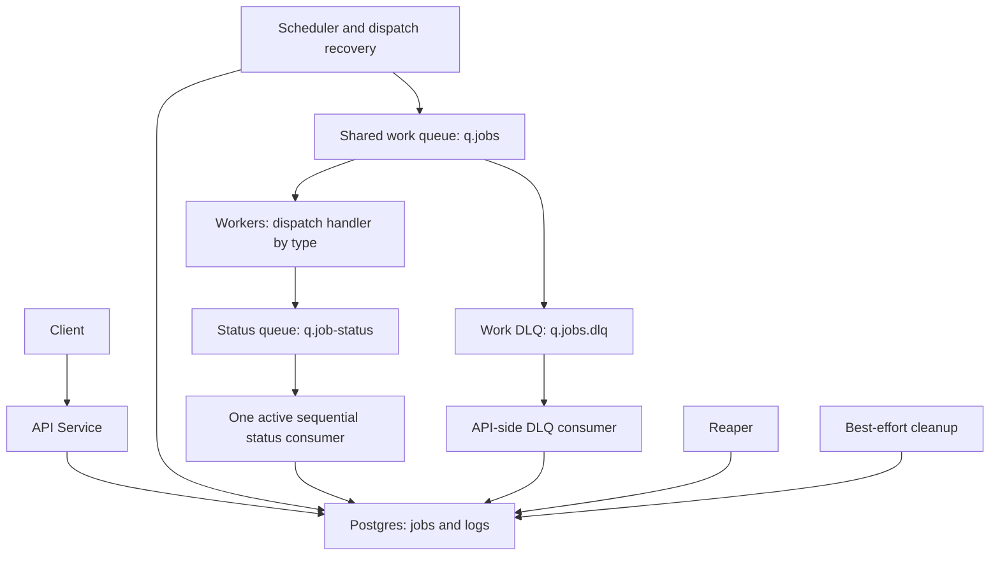
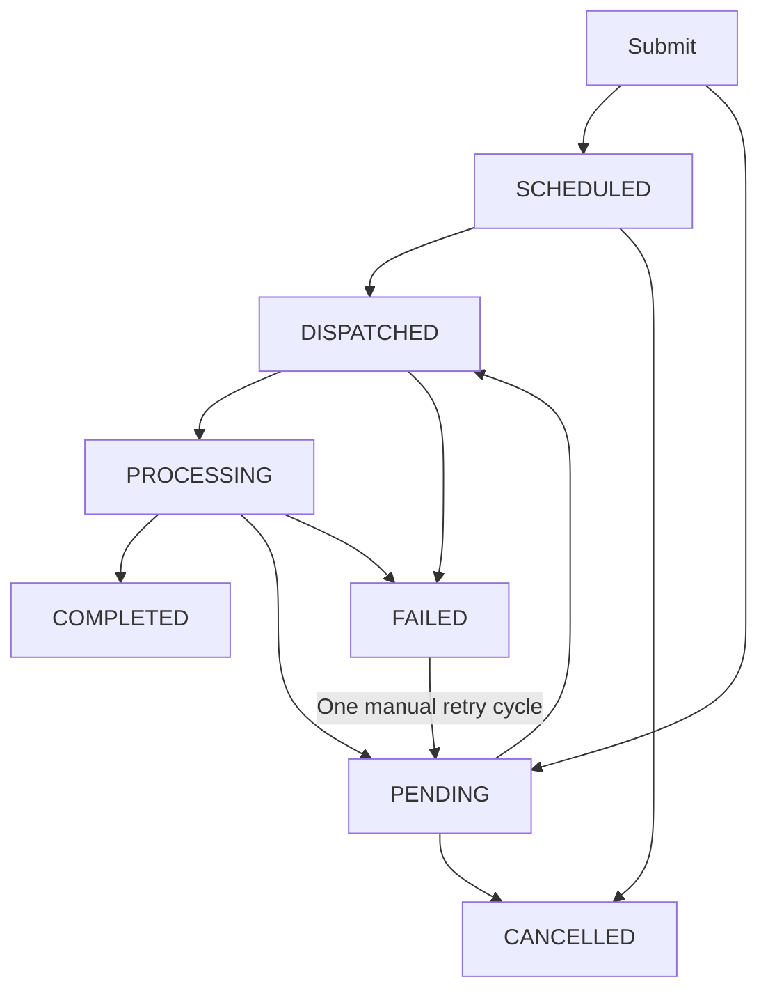

# PRD: Distributed Job Queue Service

**Execution update (2026-10-20):** Workers now own a small Redis execution registry, without access to API Postgres or API polling. Expiring owner claims suppress concurrent handling of the same dispatch, and saved outcomes replay for 24 hours without another handler invocation. Business retries use new dispatch keys. Lease expiry, Redis data loss, different attempts, and effects before outcome persistence remain outside the duplicate-suppression guarantee. This supersedes earlier unqualified statements that every work redelivery may execute again. Concrete behavior and rationale are in [DECISIONS.md, decision 18](DECISIONS.md#18-worker-owned-execution-claims-in-redis).

**Version:** 1.2

**Status:** Implemented; worker-owned Redis execution coordination added

**Stack:** Python 3.11+ / FastAPI / Postgres 16 / RabbitMQ 4.3 / Redis 7.4 / Docker Compose

**Goal:** A small, secure background job system that demonstrates correct normal work distribution, durable state, and understandable crash/restart recovery.

## 1. Overview and Goals

Build a service that accepts asynchronous jobs, executes four mock job types in separate worker processes, and exposes state, results, errors, progress, and attempt history.

This is an engineering assessment, not a production platform. Prefer the simplest mechanism that meets the assignment and make its limitations explicit. This PRD records behavior, architecture, rationale, and acceptance criteria. The execution plan will choose concrete slices, SQL, migrations, module boundaries, configuration syntax, and test mechanics.

### In scope

* Submission with type, JSON payload, priority, optional future scheduling, and an optional idempotency key.
* Email, webhook, report, and batch mock handlers.
* Lifecycle: scheduled, pending, dispatched, processing, completed, failed, cancelled.
* Automatic retry with exponential backoff and one permitted manual retry cycle per job.
* Cancellation before dispatch.
* Multiple Postgres-free workers consuming one shared work queue, with worker-owned Redis execution claims.
* Worker execution timeouts, crash recovery, and ordinary service restart recovery.
* Batch progress, structured logs, audit history, and modest best-effort cleanup.
* A fixed shared API bearer token, basic rate limiting, and dependency/queue health reporting.
* Docker Compose deployment and meaningful tests against live Postgres and RabbitMQ.
* README.md, DECISIONS.md, and AI_USAGE.md.

### Non-goals and accepted boundaries

* Real email delivery, outbound webhook calls, report storage, or other external side effects.
* Workflows/DAGs, cron, per-tenant isolation, user accounts, JWTs, or authorization scopes.
* Cancellation after dispatch, execution-admission RPCs, or worker access to Postgres.
* Exactly-once execution, a separate cross-service execution coordinator, or a separate outbox subsystem.
* Heartbeat infrastructure, automated DLQ replay, priority aging, or fairness guarantees.
* Database sharding/partitioning, broker clustering, production high availability, or production-grade retention.

## 2. Architecture

> The API service owns Postgres. Workers own execution. API-to-worker communication uses durable RabbitMQ messages.



### Responsibilities

| Component | Responsibility |
| --- | --- |
| API service | Validate/authenticate HTTP requests, own all database access, expose job queries and actions, and host background processing. |
| Scheduler | Atomically reserve eligible jobs, publish work, and recover outstanding unconfirmed publications. |
| Status consumer | Sequentially apply worker events, update attempts/results/progress, and insert audit logs transactionally. |
| Reaper | Recover processing attempts left stuck after worker failure or timeout. |
| DLQ consumer | Record a simple terminal failure for a matching current dispatch. |
| Cleaner | Remove old logs and release old terminal-job idempotency keys on a best-effort basis. |
| Workers | Consume work, choose a handler by type, enforce execution timeouts, emit status events, and acknowledge work. |
| Postgres | Persist authoritative job state, dispatch ownership, scheduling, retry budgets, results, and logs. |
| RabbitMQ | Distribute work among competing consumers and durably transport work/status messages. |

Use one durable quorum work queue, q.jobs, one durable status queue, q.job-status, and one work dead-letter queue, q.jobs.dlq, reached through dlx.jobs. Do not create separate work queues or worker services for each type.

Every worker runs the same image and supports all four handlers. Workers have RabbitMQ credentials but no DATABASE_URL or access to the API Postgres. They own a Redis execution registry on a separate internal network. An HTTP execution-admission handshake is not required.

If multiple API replicas are run, their schedulers use atomic database claims. Only one status consumer is active at a time; RabbitMQ Single Active Consumer provides status-consumer selection and failover. Work consumers remain ordinary competing consumers so multiple workers can execute different jobs concurrently.

**Rationale:** This preserves service ownership and keeps the topology small. One sequential state updater avoids ordinary status-event races without an event-processing platform.

## 3. Data Model

These are logical data requirements, not final DDL. Planning will determine exact column types, constraints, and indexes.

### 3.1 Jobs

| Field or field group | Meaning |
| --- | --- |
| id | Unique job UUID. |
| type, payload | One of email/webhook/report/batch and its validated JSON payload. |
| status | scheduled, pending, dispatched, processing, completed, failed, or cancelled. |
| priority | Integer 0–31; default 4. Suggested labels: 0 low, 4 normal, 15 high, 30 critical. |
| result, error | JSON result and current/most recent error information, as applicable. |
| progress | Integer 0–100; live batch progress, reset for a new logical execution attempt. |
| attempts | Number of logical execution attempts started in the current cycle. |
| total_attempts | Lifetime logical execution attempts across both possible cycles. |
| max_attempts | Budget per cycle, default 3, supported range 1–5. |
| manual_retry_used | Whether the one permitted manual retry cycle has been granted. Also distinguishes the initial and manual cycles. |
| claim_token | Identity of the current dispatch/logical attempt. Required in every execution event. |
| dispatched_at | When the scheduler reserved the current dispatch. |
| dispatch_confirmed_at | When broker acceptance of the current work publication was recorded; absent while publication is outstanding or uncertain. |
| dispatch_retry_at | When an unconfirmed dispatch becomes eligible for publication recovery. |
| idempotency_key | Optional unique submission key, retained for at least 24 hours. |
| scheduled_for | Optional requested execution time. |
| next_attempt_at | Earliest eligible dispatch time, including scheduling and retry backoff. |
| started_at | First accepted execution start during the job's lifetime; retained across manual retry. |
| attempt_started_at | Start of the current logical attempt, used by recovery rather than updated_at. |
| completed_at | Time of completion, final failure, or cancellation; cleared on manual retry. |
| created_at, updated_at | Creation and last database modification times. updated_at is not an execution lease. |

Assign a new claim_token for each new logical attempt. Retrying an uncertain publication or redelivering its broker message retains the same token. Invalidate the token when an attempt ends or is abandoned so its late events cannot affect a later attempt.

Increment attempts and total_attempts once when a processing event first starts that token's logical attempt. A duplicate processing event or broker redelivery must not increment them again. A failure before any execution starts may therefore leave these counters unchanged.

Reset progress and attempt-local timing when beginning a new logical attempt. Keep errors visible during automatic backoff; clear current execution output/error when the next attempt starts. Manual retry clears them immediately. Historical details remain in logs.

Indexes must support due-job selection, outstanding publication recovery, expired processing attempts, job listing, and ordered per-job logs. There is no partitioning/sharding readiness claim.

### 3.2 Job logs

Persist an associated job ID, log level (info/warning/error), message, structured metadata, and timestamp. Execution-related entries include cycle, attempt, and dispatch-token context; system entries may omit attempt context.

Any API-side component performing a state transition writes the corresponding audit log in the same database transaction. The status consumer is not the sole log writer.

**Rationale:** A jobs table and a job_logs table are sufficient. Attempt history lives in structured logs; no separate attempt-history service is needed.

## 4. Job Lifecycle



DISPATCHED means **committed to dispatch**, including a publication that is still being confirmed or recovered. It does not imply that execution has started.

| Trigger | Transition and behavior |
| --- | --- |
| Immediate submission | Create pending with next_attempt_at set to now. |
| Future submission | Create scheduled with next_attempt_at set to scheduled_for. |
| Eligible scheduler claim | Atomically move scheduled/pending to dispatched, assign a token, and commit before publishing. |
| Processing event | Move the matching dispatched job to processing and count its logical attempt once. |
| Progress event | Update the matching processing attempt without decreasing progress or extending its deadline. |
| Completion event | Move the matching processing attempt to completed; store result, progress 100, and completed_at. |
| Transient handler failure/timeout | Return to pending with backoff if the current cycle has budget; otherwise mark failed. |
| Permanent handler failure | Mark failed immediately. |
| Cancellation | Move scheduled/pending to cancelled; other states reject cancellation. |
| Manual retry | Move failed to pending only if the manual cycle is unused; grant its fresh budget. |
| Reaper recovery | Abandon a stale processing attempt and either schedule the next attempt or mark failed when budget is exhausted. |
| Matching DLQ message | Mark an outstanding dispatched/processing job failed under the simple infrastructure-failure policy. |

Use atomic state/token guards for transitions and scheduling. Old tokens cannot modify a newer attempt; terminal events cannot reopen a completed/cancelled job. State and its audit log commit together.

## 5. API Specification

All /jobs routes require a configured fixed bearer token. GET /health is available without that token for local readiness checks. Apply simple configurable per-process rate limits to submission and manual retry.

### 5.1 Submit

POST /jobs accepts type, payload, priority, scheduled_for, idempotency_key, and max_attempts. Defaults are priority 4, immediate scheduling, no idempotency key, and three attempts per cycle.

Illustrative email submission:

```json
{
  "type": "email",
  "payload": {"to": "a@example.com"},
  "priority": 4,
  "scheduled_for": null,
  "idempotency_key": "order-123",
  "max_attempts": 3
}
```

Return 202 with the new job ID and initial status. A concurrent or later duplicate idempotency key returns 200 with the existing job ID, its current status, and deduplicated=true. It never changes that job's payload, priority, schedule, or attempt budget, even if the repeated request differs.

Use strict per-type validation, bounded nonempty idempotency keys when supplied, and timezone-aware timestamps. A timestamp at or before the current time is immediately eligible. Exact validation bounds and error schemas belong in the plan.

### 5.2 Retrieve, list, and logs

* GET /jobs/{id}: return the public job representation, including state, payload, result/error, progress, current/lifetime attempts, manual-retry usage, scheduling, and public timestamps.
* GET /jobs?status=pending&type=email&limit=50&offset=0: filter by status/type and return a paginated collection.
* GET /jobs/{id}/logs?limit=50&offset=0: return paginated audit history.

Collection responses contain items, limit, offset, and total. Default limit is 50 and maximum is 100. Order jobs by created_at descending with ID as a stable tie-breaker; order logs chronologically with log ID as a tie-breaker.

Batch clients poll the job endpoint. Progress is monotonic within an attempt, may reset between attempts, and reaches 100 on successful completion. Polling need not observe every intermediate value. Dispatch tokens and internal recovery fields need not be exposed as public API fields.

### 5.3 Cancel and retry

* POST /jobs/{id}/cancel: return 200 with cancelled status only from scheduled/pending.
* POST /jobs/{id}/retry: return 202 with pending status only from failed when manual_retry_used is false.

Manual retry preserves payload, priority, original submission identity, lifetime attempt history, and logs. It resets the current-cycle attempt counter, grants the one manual cycle, clears current result/error/progress/terminal and attempt-local dispatch fields, and makes the job immediately eligible. It does not wait for the original scheduled_for again.

Unknown jobs return 404. Invalid cancellation/retry state or an already-used manual cycle returns 409. Authentication, validation, and rate-limit failures have consistent 401, 422, and 429 responses respectively.

### 5.4 Health

GET /health reports database connectivity, RabbitMQ connectivity, job counts by state, ready/unacknowledged work counts, connected work consumers, status-queue depth, and DLQ depth.

Return 200 when required dependencies are reachable and 503 when Postgres or RabbitMQ is unavailable. If only the management API is unavailable, return a degraded response with queue statistics marked unavailable. Zero work consumers is reported as degraded, not confused with unavailable database/broker connectivity.

**Rationale:** Connected consumers are a useful availability signal for this exercise, not proof of handler health. No worker heartbeat service is introduced.

## 6. Job Types and Handlers

All handlers are asynchronous mocks with no external calls. Every worker dispatches by type.

| Type | Payload and behavior | Result | Execution timeout |
| --- | --- | --- | --- |
| email | Require a valid recipient in to. Simulate sending with a 1–3 second delay. | Stable mock message_id derived from job identity. | 15 seconds |
| webhook | Require a valid HTTP(S) url, without making an outbound request. Delay 1–2 seconds; normal behavior is 80% success and 20% transient failure. | Mock status_code on success. | 15 seconds |
| report | Accept a report-parameters JSON object; delay 3–5 seconds. | Stable mock file_url derived from job identity. | 60 seconds |
| batch | Require an items list; process each item with a small delay and publish progress. An empty list completes with an empty summary. | Processed count and summary. | 180 seconds |

Planning will finalize payload details and modest input limits. No external email, HTTP, or storage integrations are needed.

Tests need deterministic mock controls, such as failing the first N logical lifetime attempts and then succeeding. This supports a successful manual retry without payload mutation. Controlled delays can exercise timeouts. These controls are for mock/test behavior, not an additional production feature.

**Rationale:** Stable mock identifiers make repeats understandable. They do not establish exactly-once execution or general side-effect deduplication.

## 7. Core Flows

### 7.1 Submit and dispatch

1. Authenticate, rate-limit, and validate the request.
2. Atomically create the job or return the existing idempotent submission.
3. On a nominal two-second scheduling tick, reserve eligible scheduled/pending jobs in a short database transaction.
4. Persist dispatched status, a new token, and outstanding-publication recovery timing; commit before publishing.
5. Publish to q.jobs with its type, payload, priority, token, and cycle/attempt context.
6. Record broker confirmation against that same dispatch. Work may start before this confirmation is recorded; the confirmation update must not overwrite execution state.

A scheduling tick is a normal pickup target, not a latency SLA under backlog or outages.

### 7.2 Future scheduling

scheduled_for and next_attempt_at prevent initial dispatch before the requested time. When due, the scheduler may move directly from scheduled to dispatched. Cancellation remains possible until that reservation commits.

### 7.3 Execution and acknowledgements

A worker receives one work message, publishes processing, runs its handler under the type's execution timeout, publishes progress as needed, publishes the final outcome, and acknowledges the work message.

Use persistent messages and publisher confirmations for work/status publication. The worker confirms its processing publication before starting the handler and confirms the final publication before acknowledging work. This confirms broker acceptance, not database application of the event; workers do not wait for API execution approval.

A business failure is still a handled work delivery: emit the appropriate failure event and acknowledge it after confirmation. The API decides business retries.

### 7.4 Automatic retry

Default three-attempt timing:

| Logical attempt | Delay before it becomes eligible |
| --- | --- |
| 1 | Immediate, or at scheduled_for for the initial cycle. |
| 2 | 30 seconds after attempt 1 fails. |
| 3 | 120 seconds after attempt 2 fails. |

Continue the same exponential progression for larger allowed budgets rather than indexing a fixed three-element array. Fast-test configuration shortens delays through the same logic.

On transient failure or timeout, return to pending with next_attempt_at set to the backoff deadline if attempts remain. Preserve priority. Permanent failures and exhausted budgets become failed with completed_at set.

Broker redelivery retries transport of the same logical attempt: it retains the token and does not grant another business attempt or backoff cycle. Physical handler execution can still repeat.

### 7.5 One manual retry cycle

A failed job may be manually reopened once. Reset attempts to zero, retain total_attempts, set manual_retry_used, and immediately make the unchanged job eligible.

For max_attempts=3, there can be up to three initial logical attempts and three logical attempts in the manual cycle. A second manual retry is rejected even if the first manual cycle ended early in a permanent failure.

### 7.6 Cancellation boundary

Cancellation and scheduler reservation race through guarded database state changes. If cancellation commits first, no work is dispatched. If dispatch commits first, cancellation returns 409, including while broker publication is outstanding.

**Rationale:** Cancellation means preventing dispatch. It does not require deleting broker messages or interrupting workers.

## 8. Concurrency and Status Processing

Use asyncio for the mock I/O-bound workload. Run workers separately from the API, with one outstanding work delivery per worker, manual acknowledgements, and bounded execution. Multiple workers consume different outstanding deliveries during normal operation.

The API hosts scheduler/publication recovery, status consumption, reaping, DLQ consumption, and cleanup. Expected dependency failures reconnect with bounded backoff. Unexpected programming errors are logged and fail the service visibly so its restart policy can act. TaskGroup alone does not provide failure isolation.

### Status-event contract

Every execution event includes job_id, claim_token, outcome/event type, and applicable progress/result/error data. Include sufficient cycle/attempt context for structured logs. Tokens are mandatory.

One active consumer processes status messages sequentially, committing each database mutation/log before acknowledging its message. Workers publish their events in order on the same channel. A status-consumer crash before commit leaves the event available for redelivery; a crash after commit but before acknowledgement must not duplicate an accepted transition or attempt count.

Duplicate or stale events are harmless to current job state. A valid current-attempt terminal event must not be silently discarded merely because its start has not yet been applied after reconnect/recovery; consumer handling must preserve that outcome. Planning will specify the simple retry/transition mechanics for that case, without adding a separate event store.

Progress applies only to the matching processing attempt and cannot decrease within it. Late progress cannot overwrite a terminal state.

### Graceful shutdown

Workers stop accepting new work, finish the current bounded handler, publish its final event, acknowledge work, and close connections. The shutdown allowance must exceed the longest supported handler timeout plus time for final publication.

The API stops scheduling, finishes current database transactions, and acknowledges committed status events before closing connections. Final worker events remain durable in the status queue if the API exits first. Forced termination uses ordinary crash recovery.

## 9. Job Pickup and Dispatch Recovery

Use short atomic database claims, with row locking such as FOR UPDATE SKIP LOCKED, to reserve due jobs without holding a transaction during broker publication or execution.

Order eligible jobs by priority descending, next_attempt_at ascending, then a stable tie-breaker. Commit dispatched status and ownership before publishing. Ordinary scheduler selection excludes dispatched and processing jobs.

### Recovering an interrupted publication

The job row itself records outstanding publication; there is no separate outbox table.

* Before publication, persist the dispatch token and a bounded future recovery time.
* Once broker acceptance is confirmed, record dispatch_confirmed_at.
* If publication fails or its outcome is uncertain, keep the same outstanding dispatch and retry it after the recovery delay.
* If the API dies between reservation and publication, a later scheduler recovers that unconfirmed dispatch.
* Recovery reservation is atomic so competing API replicas do not routinely recover the same row together.
* A confirmed dispatch waiting for a worker is not repeatedly republished or timed out just because the queue is backed up.

A crash after broker acceptance but before confirmation is recorded can cause duplicate publication. Reuse the token so database events remain attributable to the same logical attempt; this does not prevent repeated physical execution.

**Rationale:** This closes the stranded-job gap using existing job state, while accepting the small duplicate window inherent in an uncertain database/broker handoff.

## 10. Priority Behavior

Apply priority in both eligible-job selection and RabbitMQ message priority. Use RabbitMQ 4.3 quorum priority support for the 0–31 range, normally using the four named levels.

The promised behavior is preference for higher-priority jobs of the same type among jobs eligible and still waiting for dispatch/delivery. The shared queue also compares priorities across types, but the API promises no particular cross-type execution order or per-type capacity reservation.

Priority does not preempt running work, override scheduling/backoff, or reorder messages already delivered to workers. Broker recovery redeliveries may have different ordering from newly published work. Scheduled business retries republish with their original priority.

**Tradeoff:** Strict priority can starve low-priority work. Four suggested levels simplify use; they do not eliminate starvation. No aging or fairness subsystem is included.

## 11. Crash Recovery, Timeouts, and Dead Letters

### 11.1 Bounded execution and reaping

Workers enforce the type-specific timeout around each handler. A timeout produces a transient failure event so the normal retry budget applies.

The API reaper checks processing attempts using attempt_started_at plus the type's timeout and a small recovery allowance. A nominal ten-second polling interval is sufficient; recovery is eventual rather than an exact wall-clock SLA.

General row changes and batch progress do not extend the execution deadline. No heartbeat service is required for these bounded mock jobs.

Before abandoning an attempt, re-check its current state, token, and expiry atomically. A concurrent completion must not be overwritten. Invalidate the abandoned token, log recovery, and either schedule the next logical attempt with backoff or mark failed when its cycle is exhausted.

### 11.2 Expected failure behavior

| Failure point | Expected recovery |
| --- | --- |
| API dies after reservation but before work publication is confirmed/recorded | Recover the outstanding dispatch from Postgres and republish with the same token. |
| Worker dies before processing publication | RabbitMQ can redeliver the unacknowledged work; no logical attempt has yet been counted. |
| Worker dies after processing but before final outcome | RabbitMQ may redeliver the same attempt first; otherwise the reaper abandons the stale attempt and applies the retry budget. |
| Worker dies after saving its outcome or final publication but before work acknowledgement | Work redelivery replays the Redis-recorded outcome without executing again while retained; guarded status updates preserve the accepted outcome. |
| Status consumer dies | Unacknowledged status messages redeliver; transactional state/log writes prevent partially applied transitions. |
| API, worker, or broker ordinarily restarts | Persisted jobs and durable broker messages remain available; reconnect/recovery resumes processing. |

RabbitMQ assigns an outstanding delivery to one consumer during normal operation. Connection loss can cause redelivery while the old process is still executing; uncertain publication can also create two messages for one job. Tokens protect persistent state, not physical execution exclusivity.

**Accepted guarantee:** At-least-once execution with guarded persistent state. No claim of exactly-once effects or absolute prevention of overlapping execution during failures.

### 11.3 Simple DLQ policy

Use one work DLQ and a small API-side consumer. Malformed work and deliveries rejected under the simple infrastructure-failure policy can be dead-lettered. A matching current dispatched/processing job becomes failed with a useful error and audit log. Stale DLQ messages cannot fail a newer attempt or overwrite a terminal outcome.

If status publication fails while the work channel remains usable, rejecting without requeue can send the work to the DLQ. If the connection itself is lost, that rejection may be impossible; normal unacknowledged-delivery recovery applies instead.

**Accepted tradeoffs:** A transient infrastructure fault may permanently fail an otherwise valid job and require its one manual retry. No separate infrastructure retry framework, automatic replay, or lossless DLQ-transfer guarantee is provided. The plan will select a small delivery limit consistent with the documented crash-recovery tests.

## 12. Submission Idempotency

A database uniqueness constraint enforces the optional idempotency key, including concurrent submissions. A duplicate returns the existing job in its current state and never edits it.

Retain keys for at least 24 hours; the simple cleanup policy may release keys on terminal jobs older than 30 days. No key is released from an active job. With best-effort cleanup, retention can be longer.

**Rationale:** Submission deduplication prevents duplicate job records. It does not deduplicate repeated worker execution or make external effects exactly once.

## 13. Logging and Best-Effort Cleanup

Emit structured JSON logs with component context and job_id, type, cycle, attempt, and token when applicable. Lifecycle logs cover submission, dispatch, processing, progress, completion, failure, cancellation, retry, timeout/recovery, and DLQ handling.

Database audit logs are written atomically by the component performing the corresponding transition. Repeated status delivery must not duplicate accepted transition logs; detailed handler output can remain on stdout.

Periodically delete old job logs in small batches and release eligible old idempotency keys. A 30-day age threshold with hourly best-effort cleanup is sufficient.

**Accepted tradeoff:** Cleanup does not guarantee bounded total storage or archive job history. Job rows may remain indefinitely. This is modest housekeeping, not production retention management.

## 14. Security and Configuration

Protect /jobs routes with one fixed shared bearer token configured through the environment and validated by the API. There is no JWT generation/validation, login flow, scope model, or per-user authorization.

The token authenticates HTTP callers. Workers using only RabbitMQ authenticate through broker credentials and do not need an API call solely for authentication. Use one broker user locally; per-service broker identities are future production work.

Keep secrets out of source code, provide documented local environment setup, run application containers as non-root, and expose only the API outside the Compose network. Supply database credentials only to the API.

Use simple configurable per-process submission/retry rate limits. Limits are not globally coordinated across API replicas. Exact defaults and environment variable names belong in the execution plan.

**Rationale:** These controls provide basic security without an identity platform. DECISIONS.md must distinguish shared exercise credentials from stronger production authentication/authorization.

## 15. Deployment Requirements

Docker Compose must start the API, shared worker service, Postgres, and RabbitMQ through a documented local command. Support scaling the worker service without choosing a job type.

Require persisted Postgres and RabbitMQ data, dependency readiness, repeatable schema initialization, and reconnect behavior after ordinary restarts. Use a RabbitMQ version pinned to the selected 4.3-compatible behavior.

Local scope is one database and one broker. A quorum queue on a single broker is not a replicated high-availability deployment. Ordinary restart recovery does not promise survival of permanent disk/volume loss.

Provide a reproducible multiple-worker demonstration. If the multiple-API acceptance scenario is run, use a working local arrangement without conflicting host ports. Exact Compose definitions, volume declarations, health commands, migration mechanism, shutdown settings, and replica routing belong in the execution plan.

## 16. Acceptance and Testing

Use live Postgres and RabbitMQ for integration/e2e evidence. Handler behavior remains mocked by design. Add focused worker tests where they directly validate message handling and timeout/shutdown behavior; do not substitute dependency mocks for the integration evidence.

### Functional acceptance

1. Submit and retrieve each job type; list/filter/page jobs and logs with stable ordering.
2. Complete email/report jobs with their documented mock results and webhook jobs with controlled outcomes.
3. Persist errors and apply the documented automatic retry timing and attempt limit, including supported non-default budgets.
4. Grant one fresh manual retry cycle, preserve lifetime history, and reject a second manual retry. A deterministic failure-then-success scenario needs no payload change.
5. Cancel scheduled/pending jobs. A cancellation/dispatch race has one winner; dispatched/processing jobs reject cancellation.
6. Return one job for concurrent duplicate-key submissions; later duplicates return its current state without mutation.
7. Demonstrate priority within one type by queuing eligible jobs before enabling work consumption. Do not expect preemption.
8. Never dispatch a future-scheduled job early.
9. Show batch progress is monotonic within an attempt, may reset on another attempt, and ends at 100 on success. Empty batches have a valid summary.
10. Verify fixed-token authentication, basic validation/errors, and meaningful health/degraded responses.

### Recovery and concurrency acceptance

11. With workers stopped across scheduler ticks, confirmed work does not multiply continuously. Competing schedulers do not ordinarily reserve the same eligible job.
12. Interrupted publication recovers after API restart; a confirmed queued job is left waiting rather than routinely republished.
13. Duplicate/stale status and DLQ events cannot corrupt the current attempt, increment its counters twice, or overwrite accepted terminal state. Status-consumer restart retains committed outcomes/logs.
14. Worker failure recovers through broker redelivery or the reaper as appropriate. Reaper tests separately exercise the stale-processing path rather than assuming it always wins the race.
15. Handler timeouts apply the retry budget, progress cannot extend the deadline, and guarded recovery cannot overwrite concurrent completion.
16. Multiple workers process normal deliveries concurrently without ordinary duplicate pickup. Multiple API replicas demonstrate scheduler safety and one active sequential status consumer.
17. Graceful shutdown completes a bounded current job. Forced termination follows the documented recovery policy.
18. Ordinary API/broker/worker restarts preserve persisted state and queued work and allow processing to resume.

Use deterministic mock controls and shortened timing configuration for repeatable tests through the same business logic. Accepted at-least-once recovery can repeat physical execution; database attempts/logs alone are not proof of exactly-once side effects.

These criteria can be grouped into a small set of meaningful scenarios. Execution planning will select fixtures, fault injection, assertions, and slice-specific evidence rather than building an exhaustive distributed fault matrix.

## 17. Submission Artifacts and Planning Handoff

### Required submission documents

* **README.md:** Local environment setup, how to run, how to run tests, an authenticated example submission, worker scaling, and a brief architecture overview.
* **DECISIONS.md:** Chosen approach, reasons, and tradeoffs for job pickup, API-owned database access, dispatch-before-publication, cancellation cutoff, at-least-once execution, crash/restart recovery, priority, retry timing, and the single manual cycle. Explain the simple DLQ policy, fixed shared token, per-process rate limits, best-effort cleanup, and single-node deployment. Include one honest improvement with more time.
* **AI_USAGE.md:** Tools used, specific useful contributions, incorrect suggestions that needed correction (especially concurrency), and areas where AI struggled.

These files are submission deliverables to produce during execution; this PRD records the decisions they must explain.

### Planning boundary

The next session should turn this agreed design into concrete vertical execution slices. It should define database migrations/queries, message schemas and consumer mechanics, module/file ownership, dependency configuration, deployment commands, and focused evidence for each slice.

Keep the agreed simplifications: workers without API-database access, three queues serving distinct roles, job-row dispatch recovery, one active status consumer, bounded mock execution, and explicit failure tradeoffs. Do not add production subsystems simply to remove limitations already accepted here.

### Source references

* [Original assignment](PY-Backend-Senior-job-queue-Kit-Assignment.pdf).
* [RabbitMQ acknowledgements and publisher confirms](https://www.rabbitmq.com/docs/confirms): broker delivery/confirmation boundaries and redelivery.
* [RabbitMQ Single Active Consumer](https://www.rabbitmq.com/docs/consumers#single-active-consumer): sequential status consumption with broker-managed failover.
* [RabbitMQ priority support](https://www.rabbitmq.com/docs/priority): RabbitMQ 4.3 quorum priorities and ordering limitations.
